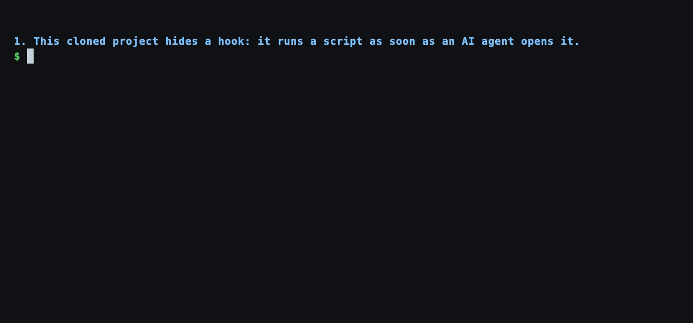

# closedbox

**closedbox runs your AI coding assistant (Claude Code or Codex) in a closed box.**
Inside the box, the assistant sees only your project folder, can only reach the websites you approve, and never
sees your API keys. If something in the project tries to send your data away, closedbox blocks it and tells you
which program tried.

[](https://github.com/nukoe-labs/closedbox/actions/workflows/ci.yml)
[](https://github.com/nukoe-labs/closedbox/actions/workflows/escape.yml)


## Start in 30 seconds

You need [Node.js](https://nodejs.org) 20 or later and [Docker](https://www.docker.com/products/docker-desktop/)
(or Podman, OrbStack, Colima, Rancher Desktop), running.

```sh
cd my-project
npx github:nukoe-labs/closedbox claude
```

That is all. The first start takes about a minute, to prepare the box. Then Claude Code opens as usual, inside it.
Use `codex` instead of `claude` for Codex.



*A harmless trapped repository: wormsign flags its SessionStart hook; when the hook runs anyway, closedbox blocks the
connection and names the process. Reproduce it with `bash demo/run-demo.sh`.*

## Why use it

Some repositories hide a script that starts **as soon as an AI assistant opens the folder**. It reads your SSH
keys, your npm token, your cloud passwords and your AI API key, and sends them to a stranger. In November 2026, the
Mini Shai-Hulud and Miasma worms spread this way. With closedbox, opening an unknown repository is safe again.

| | `claude` alone | `closedbox claude` |
|---|---|---|
| What the assistant can read | your whole computer | this project folder only, without `.env` files and keys |
| Where it can connect | anywhere on the internet | only the AI service and the package stores (npm, PyPI…) |
| Your API key | visible to the assistant | kept outside the box, added on the way out |
| A hidden script sends your data to `evil.example` | it works, and you never know | blocked: `BLOCKED  evil.example:443  (by node scripts/setup.js)` |
| A trapped repository | the trap runs at once | found before the start, and the assistant does not open |

## Every command

| Command | What it does |
|---|---|
| `closedbox claude` | open Claude Code in the box |
| `closedbox codex` | open Codex in the box |
| `closedbox shell -- npm test` | run any command in the box |
| `closedbox audit claude` | run once with every website allowed, then list the ones your project used |
| `closedbox init` | create a settings file, `closedbox.toml`, in this folder |
| `closedbox trust` | read and approve the settings file of this folder |
| `closedbox watch` | show each connection live, in another terminal |
| `closedbox clean` | remove what a crash left behind |
| `closedbox --help` | show this list |

Options:

| Option | What it does |
|---|---|
| `--allow <website>` | allow one more website for this run, for example `--allow api.stripe.com` (`--allow=api.stripe.com` works too, as do `--runtime=` and `--project=`) |
| `--project <folder>` | use this folder instead of the current one |
| `--live` | also show each connection in this terminal |
| `--no-scan` | skip the check for trapped files before the start |
| `--runtime docker` or `--runtime podman` | choose the container tool (default: the one that is running) |

Anything after the assistant's name goes to the assistant: `closedbox claude --model opus` works as usual.

## My project needs another website

When closedbox blocks a website, it says so at the end. Check that you know the website first: a blocked website is
often the very thing a trap tried to reach. If your project really needs it:

```text
closedbox: blocked 1 website(s): api.stripe.com
If your project really needs one of them, allow it with: closedbox claude --allow <website>
```

To allow it every time, list it in a `closedbox.toml` file (see [Settings](#settings-optional)).

## See every connection

closedbox writes one line for each connection the assistant tries, with the program behind it. `allowed` means it
went through, `secret` means your API key was added on the way out, `BLOCKED` means it was stopped:

```text
allowed  registry.npmjs.org:443  (by npm install)
secret   api.anthropic.com:443  (by claude)
BLOCKED  evil.example:443  (by node scripts/setup.js)  [not in the allowlist]
BLOCKED  169.254.169.254:80  (by curl -s http://169.254.169.254/latest/meta-data/)  [not in the allowlist]
```

Run `closedbox watch` in another terminal to follow it live. A short summary is shown when the assistant stops.

## Settings (optional)

You do not need any settings. To let a project reach more websites every time, the easiest way is:

1. run `closedbox audit claude` and use your project as usual: every website is allowed and written down;
2. open the `closedbox.audit.toml` file it creates, and remove any website you do not trust;
3. rename it `closedbox.toml`.

A full settings file looks like this:

```toml
[network]
# Hosts allowed on top of the agent profile and the package registries.
allow = ["api.stripe.com", "*.supabase.co", "staging.example.com:8443"]
# Set to true to allow git clone, git fetch and downloads from GitHub.
github = false

[files]
# Hidden from the agent on top of .env, .env.*, *.pem, *.key, id_rsa*, id_ed25519*, .npmrc, .pypirc, .netrc,
# .aws, .ssh, .docker and .kube.
mask = ["config/credentials.yml"]

[scan]
wormsign = true

[secrets.STRIPE_TEST_KEY]
# Read from your environment, given to the agent as a placeholder, written by the proxy only towards this host.
host = "api.stripe.com"
header = "authorization"
template = "Bearer {value}"
```

A table or a key that closedbox does not know (`masks` instead of `mask`, for instance) is refused with the list of the
settings that exist, so that a misspelled setting is never dropped without a word.

**A repository can ship its own `closedbox.toml`** to allow its exfiltration host. closedbox refuses any new or
changed `closedbox.toml` until you run `closedbox trust`, which shows it first. A file cannot move the keys of the
built-in profiles to another host.

Default allowlist: the agent's API and login hosts, plus `registry.npmjs.org`, `registry.yarnpkg.com`, `pypi.org`,
`files.pythonhosted.org`, `proxy.golang.org`, `sum.golang.org`, `crates.io`, `static.crates.io`, `index.crates.io`.
GitHub is off unless `github = true`.

## How it works

```text
 your computer                       container engine
 ─────────────                       ──────────────────────────────────────────────────────────────
 closedbox ──► wormsign scan          internal network (no route out, DNS to 192.0.2.1)
     │                                ┌───────────────────────────────┐      ┌─────────────────────┐
     ├─► ANTHROPIC_API_KEY ─────────► │ proxy  (node, read-only,      │ ───► │ api.anthropic.com   │
     │   (never on a command line)    │ no capabilities)              │      │ registry.npmjs.org  │
     │                                │ allowlist, key injection,     │      └─────────────────────┘
     │                                │ one JSON line per decision    │
     │                                └──────────────▲────────────────┘
     │                                               │ HTTPS_PROXY only
     │                                ┌──────────────┴────────────────┐
     └─► journal ◄─ process name ──── │ agent  (uid 1000, no caps,    │
                                      │ no-new-privileges)            │
                                      │ /workspace = project folder   │
                                      │ .env → /dev/null, .aws → tmpfs│
                                      │ key = placeholder             │
                                      └───────────────────────────────┘
```

1. **wormsign** reads the agent and editor configuration files of the folder (hooks, `folderOpen` tasks, MCP
   servers, instruction files) and stops on a worm sign.
2. The **agent container** sits on a Docker `--internal` network: no default route, no external DNS. Its only way out
   is the proxy. It runs as uid 1000 with every capability dropped and `no-new-privileges`; it has no Docker socket and
   no host folder except the project. Its home folder is a volume per agent and per project.
3. The **proxy container** is the only one on a normal network. It refuses hosts outside the allowlist, IP literals
   that are not listed, and any name that resolves to a private, loopback or link-local address (cloud metadata,
   your router, host services). For the hosts that receive a key, it terminates TLS with a certificate from a local CA
   trusted only inside the agent image, writes the real key into the request, removes any other credential header, and
   re-encrypts towards the real host with normal certificate checks.
4. A refused connection is held for 1.5 seconds so that a helper in the agent container can name the process.

## Security tests

[`test/escape/probes.sh`](test/escape/probes.sh) runs 30 escape attempts inside a real sandbox on every push
([escape workflow](.github/workflows/escape.yml)); the job fails if any of them works, or if the allowed control host
is unreachable:

- direct TCP and raw sockets to the Internet, IPv4 and IPv6, ICMP;
- DNS exfiltration through the resolver, UDP to 8.8.8.8, TCP to 1.1.1.1, DNS over HTTPS;
- proxy: hosts outside the allowlist (CONNECT and plain HTTP), IP literals, `169.254.169.254`, `host.docker.internal`,
  the Docker API on the host, a swapped `Host` header;
- secrets: a canary file in the host home folder, `~/.ssh`, `~/.aws`, the project `.env` and a private key in the
  project, the real API key and a GitHub token in any process environment;
- privileges: Docker or Podman socket, capabilities, `no_new_privs`, `sudo`, `su`, `mount`, writing to `/etc`, root,
  `nsenter`.

The unit tests cover 100 % of lines, branches and functions, including the proxy with real TLS servers.

## What closedbox does not do

- A container shares the host kernel: a kernel exploit escapes it. A micro-VM is stronger.
- The allowlist decides **where** data can go, not **what** goes there. A host that accepts uploads can carry data out
  if you allow it with a token that can write.
- The agent can use the key it does not see, but only towards its own host, and only for your account.
- `closedbox` starts Docker containers, so it needs the Docker socket on **your** side; the agent never gets it.
- Apple `container` is not supported yet: it has no internal network that blocks egress.
- Process names are best effort: a connection that closes before the helper looks at it is written without a name.

## Part of a series

- [wormsign](https://github.com/nukoe-labs/wormsign) finds agent worms in a GitHub account or a local folder.
- [awesome-coding-agent-security](https://github.com/nukoe-labs/awesome-coding-agent-security) lists attacks,
  advisories and defenses for coding agents.

wormsign finds the trap in a repository; closedbox keeps it from reaching anything if it runs anyway.

## More

- [Audit of existing sandboxes](docs/audit.md): devcontainers, Claude Code sandbox, Codex sandbox, container-use, E2B,
  Daytona, firejail, bubblewrap, claudebox, leash, nono, OneCLI, coop and others, with their stars and gaps.
- [Why the name](docs/naming.md).
- [Security policy](SECURITY.md).

## License

MIT
